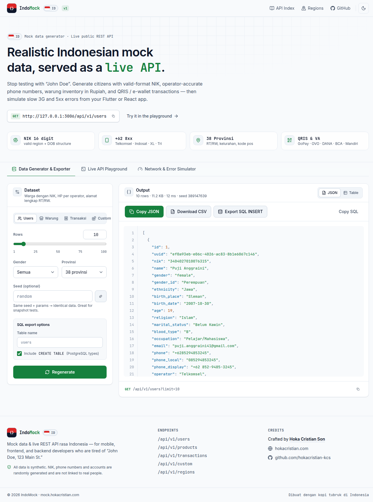
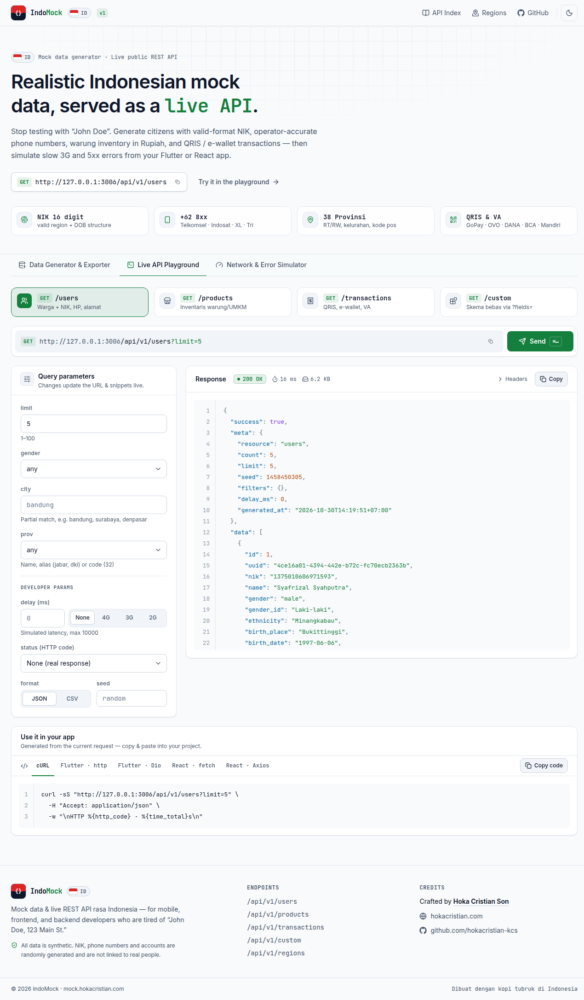
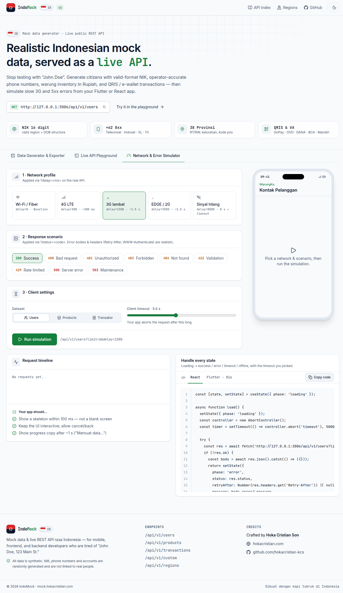

# 🇮🇩 IndoMock

<p align="center">
  <strong>Indonesian Mock Data Generator & Live Public REST API for Developers</strong><br />
  Realistic synthetic data for mobile, frontend, and backend engineering across Nusantara.
</p>

<p align="center">
  <a href="https://mock.hokacristian.com"></a>
  
  
  
  
</p>

---

## 📸 Screenshots & Previews

### 1. Data Generator & Exporter
Pilih dataset kustom, tentukan jumlah baris, preview JSON real-time, dan export instan ke JSON, CSV, atau query SQL `INSERT`.
<p align="center">
  
</p>

### 2. Live API Playground
Interactive tester untuk endpoint REST API publik lengkap dengan status latency (ms) dan copyable code snippets untuk cURL, Flutter/Dart, dan React Axios.
<p align="center">
  
</p>

### 3. Network & Error Simulator
Uji ketahanan aplikasi mobile dan frontend terhadap koneksi lemot (`?delay=1500` simulasi 3G) atau simulasi HTTP error (`?status=401/404/500`).
<p align="center">
  
</p>

---

## 🌟 Kenapa IndoMock?

Library mock data global (seperti Faker.js) biasanya sangat *US-centric* (John Doe, ZIP code 5 digit, mata uang USD). **IndoMock** dirancang khusus dari nol dengan aturan lokalitas Indonesia:

* 👤 **Users / Penduduk:** Nama realistis lintas suku (Jawa, Sunda, Batak, Minang, Bali, Urban Modern), **NIK KTP 16-digit berstruktur valid** (sesuai kode wilayah BPS + tanggal lahir, wanita +40), nomor HP `+62 8xx` dengan prefix operator asli (Telkomsel, Indosat, XL, Tri), serta alamat lengkap 38 provinsi.
* 🛒 **WarungKu / UMKM Products:** Katalog produk ritel khas warung & minimarket Indonesia (Indomie, Beras Pandan Wangi, Minyak Filma, Telur, Kopi Kapal Api) lengkap dengan harga IDR (Rp), SKU, barcode EAN-13 (prefix GS1 899 ber-check digit valid), dan status stok.
* 💳 **Transactions / Fintech:** Record transaksi kasir realistis dengan ID `TRX-YYYYMMDD-XXXX`, timestamp WIB, line items, metode bayar lokal (QRIS, GoPay, OVO, ShopeePay, DANA, Virtual Account BCA/Mandiri), dan status pelunasan.
* ⏱️ **Zero-Config Developer Engine:** Dukungan parameter pengujian bawaan seperti `?delay=<ms>`, `?status=<code>`, `?seed=<num>`, dan `?format=csv`.

---

## ⚡ Quick Start & API Usage

Endpoint publik live di: `https://mock.hokacristian.com/api/v1`

### 1. Ambil Data Pengguna Indonesia
```bash
# 5 Pengguna dari Jawa Barat
curl "https://mock.hokacristian.com/api/v1/users?limit=5&prov=jabar"
```

### 2. Simulasi Jaringan Lambat (Mobile 3G)
```bash
# Data produk dengan delay 1.5 detik
curl "https://mock.hokacristian.com/api/v1/products?limit=10&delay=1500"
```

### 3. Simulasi HTTP Error Code
```bash
# Menguji Error Boundary / Toast di frontend (simulasi 401 Unauthorized)
curl "https://mock.hokacristian.com/api/v1/users?status=401"
```

### 4. Export Langsung ke Format CSV
```bash
# Unduh daftar transaksi kasir dalam format CSV
curl "https://mock.hokacristian.com/api/v1/transactions?limit=50&format=csv" -o transaksi.csv
```

---

## 📚 REST API Reference

| Endpoint | Method | Parameter Utama | Deskripsi |
| :--- | :---: | :--- | :--- |
| `/api/v1/users` | `GET` | `limit`, `gender`, `city`, `prov` | Data profil penduduk, NIK, alamat lengkap |
| `/api/v1/products` | `GET` | `limit`, `category`, `min_price`, `max_price` | Katalog produk warung & ritel UMKM |
| `/api/v1/transactions` | `GET` | `limit`, `status`, `payment_method` | Transaksi kasir/POS & e-wallet Indonesia |
| `/api/v1/custom` | `GET/POST` | `fields=name:type,...` | Custom schema generator (35+ tipe data lokal) |
| `/api/v1/regions` | `GET` | — | Daftar 38 provinsi & kode pos referensi |
| `/api/v1/health` | `GET` | — | Server health check endpoint |

---

## 💻 Menjalankan Secara Lokal (Self-Host)

```bash
# Clone repository
git clone git@github-hokacristian:hokacristian/indomock.git
cd indomock

# Install dependensi
npm install

# Mode Development (Vite hot-reload + Express API)
npm run dev

# Build untuk Production
npm run build

# Menjalankan Server Production
npm start
```

Default server akan mendengarkan di `http://localhost:3006`.

---

## 👨‍💻 Author & Credits

Dibuat dengan dedikasi untuk developer Indonesia oleh:
* **Hoka Cristian Son**
* Website: [hokacristian.com](https://hokacristian.com)
* GitHub: [@hokacristian](https://github.com/hokacristian) / [@hokacristian-kcs](https://github.com/hokacristian-kcs)

---

## 📄 Lisensi

Didistribusikan di bawah lisensi MIT. Silakan gunakan secara bebas untuk keperluan pengujian aplikasi, portofolio, maupun riset.
